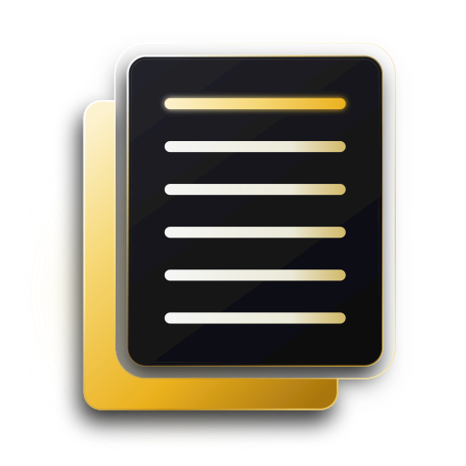
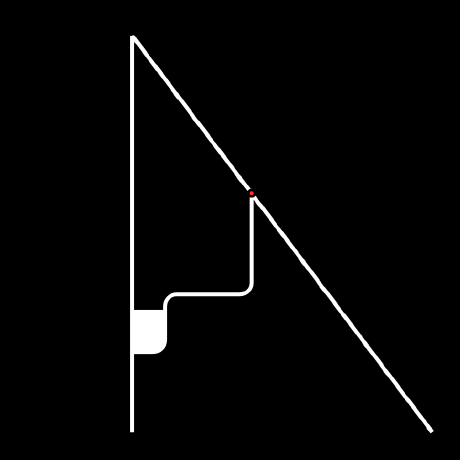

<div align="center">



# Monolith Notes

### The Distraction-Free Markdown Journal & Personal Knowledge Graph.
#### Pure Local-First File Sovereignty. Zero Subscriptions. Available on Android, macOS, Windows & Linux.

<br/>

[](https://github.com/ayush-rdev/monolith-notes/releases/tag/v2.7.0)
[](https://github.com/ayush-rdev/monolith-notes/releases/tag/v2.7.0)
[](https://github.com/ayush-rdev/monolith-notes/releases)
[](https://github.com/ayush-rdev/monolith-notes/releases)
[](https://github.com/ayush-rdev/monolith-notes/releases/tag/v2.7.0)
[](https://obsidian.md)
[](LICENSE)

<br/>

> *"Stop paying monthly subscriptions to access your own thoughts. Write in raw, timeless CommonMark. Explore ideas across a 120Hz neural galaxy. Keep every byte on your own hardware forever."*

<br/>

[⬇️ **Download Android APK**](https://github.com/ayush-rdev/monolith-notes/releases/download/v2.7.0/Monolith-Notes-v2.7.0.apk) • [🐧 **Download Linux DEB**](https://github.com/ayush-rdev/monolith-notes/releases/download/v2.7.0/monolith-notes-2.7.0-linux-amd64.deb) • [📦 **All Releases**](https://github.com/ayush-rdev/monolith-notes/releases) • [Manifesto](#-the-manifesto-file-over-app) • [Core Features](#-the-five-pillars) • [Co-Authors](#-co-authors--contributors)

</div>

---

## ⚡ Cross-Platform Downloads

Monolith is a unified, synchronized experience designed for mobile and desktop. Every note syncs seamlessly via your choice of Google Drive, E2EE Monolith Cloud, or standard WebDAV.

| Platform | Format | Status | Download |
| :--- | :--- | :---: | :--- |
| **Android** | `.apk` (ARM64 / Universal) | **Live (v2.7.0)** | [⬇️ Download Monolith-Notes-v2.7.0.apk](https://github.com/ayush-rdev/monolith-notes/releases/download/v2.7.0/Monolith-Notes-v2.7.0.apk) |
| **Linux** | `.deb` (Debian, Ubuntu, Mint) | **Live (v2.7.0)** | [⬇️ Download monolith-notes-2.7.0-linux-amd64.deb](https://github.com/ayush-rdev/monolith-notes/releases/download/v2.7.0/monolith-notes-2.7.0-linux-amd64.deb) |
| **Linux** | `.tar.gz` (Arch, Fedora, Generic) | **Live (v2.7.0)** | [⬇️ Download monolith-notes-2.7.0-linux-x86_64.tar.gz](https://github.com/ayush-rdev/monolith-notes/releases/download/v2.7.0/monolith-notes-2.7.0-linux-x86_64.tar.gz) |
| **macOS** | `.dmg` (Universal Apple Silicon & Intel) | **Building** | [📦 GitHub Releases](https://github.com/ayush-rdev/monolith-notes/releases) |
| **Windows** | `.exe` (NSIS Installer) / `.msi` | **Building** | [📦 GitHub Releases](https://github.com/ayush-rdev/monolith-notes/releases) |

---

## 🏛️ The Manifesto: File Over App

Modern note-taking apps have broken their promise to writers and thinkers:
- They trap your intimate thoughts behind **monthly subscription paywalls**.
- They lock your words in **opaque proprietary cloud databases** (`.sqlite`, proprietary JSON schemas).
- They analyze your keystrokes for advertising and lock you out when your connection drops.

**Monolith rejects this completely.**

1. **You Own the Files**: Every note is a transparent, honest, plain-text CommonMark `.md` file stored locally in `Documents/MonolithNotes/`.
2. **Plain Text is Eternal**: If Monolith disappears 30 years from today, your thoughts remain fully readable and editable in Obsidian, Logseq, VS Code, vim, or whatever tools exist in the future.
3. **Zero Telemetry**: No trackers, no surveillance, no ads, no lock-in. 100% private.
4. **Tactile Luxury**: Built with native Jetpack Compose on Android and native Rust + Tauri v2 on Desktop. 0ms typing response, fluid springs, true-black OLED contrast.

---

## 🔮 The Five Pillars

```
                                  ┌────────────────────────────────┐
                                  │         Monolith Notes         │
                                  └───────────────┬────────────────┘
                                                  │
         ┌────────────────────────┬───────────────┴───────────────┬────────────────────────┐
         │                        │                               │                        │
         ▼                        ▼                               ▼                        ▼
┌──────────────────┐    ┌──────────────────┐            ┌──────────────────┐    ┌──────────────────┐
│  FILE OVER APP   │    │  GALAXY TOPOLOGY │            │  NEURAL OPERATOR │    │ NATIVE MULTI-OS  │
│  Pure .md Vault  │    │  Force-Directed  │            │  Grounded Vault  │    │ Android + Mac +  │
│  Obsidian 100%   │    │  120Hz Canvas    │            │  RAG Zero-Fluff  │    │ Windows + Linux  │
└──────────────────┘    └──────────────────┘            └──────────────────┘    └──────────────────┘
```

### 1. 🌌 Obsidian-Grade Galaxy Knowledge Graph
Explore the topology of your mind. Monolith parses your notes, tags, and `[[wikilinks]]` in real time and renders an interactive, force-directed graph running at a silky 120Hz.
- **Topological Physics Engine**: Smooth repulsion ($k_{\text{repulse}}$), spring tension, and damping calibrated for large vaults (>500 notes).
- **Landmark Hub Recognition**: Identifies core intellectual clusters and displays subtle monospace labels for effortless visual orientation.
- **Unified Touch Processor**: Seamless 1-finger physics drag, 2-finger focal-centered pinch zoom, and tactile haptic feedback.

### 2. ⚛️ Grounded Neural Retrieval Operator (AI RAG)
Query your notes as an activated neural network. Monolith treats every note as a synaptic neuron, running local TF-IDF scoring and spreading activation across your link graph:
$$\mathcal{S}(n) = \text{TF-IDF}(q, n) + \sum_{j \in \text{Adj}(n)} \lambda \cdot \mathcal{S}(j) \quad \mid \quad \lambda = 0.25, \; k = 7$$
- **Optical Defocus Depth Scrim**: Un-retrieved nodes dim smoothly into dark obsidian blur ($0.06$ alpha), spotlighting retrieved thoughts.
- **Proportional Radiant Illumination**: Retrieved neurons glow proportionally to their relevance $\sigma$, with traveling action-potential pulses along active synapses.
- **100% Grounded Invariant**: Zero fluff, zero hallucinations. Responses are strictly synthesized against verified excerpts from your own notes.

### 3. 🖥️ Monolith Desktop (macOS, Windows, Linux)
A bespoke desktop companion built with **Tauri v2** and **React 19**, matching mobile's distraction-free aesthetic with desktop productivity:
- **Live WYSIWYG CommonMark**: Live markdown formatting mirroring native mobile transforms (headings, checklists `○`/`✓`, bold/italic, code blocks, quote callouts, and wikilinks).
- **Direct Filesystem Vault**: Mounts directly to `~/Documents/MonolithNotes/` with instant file change synchronization.
- **E2EE Vault Sync**: Encrypted synchronization with AES-256-GCM, full ZIP export, and WebDAV compatibility.

### 4. ✍️ Tactile Craftsmanship & OLED True-Black
- **Bespoke Inset Grouped Hierarchy**: True-black background (`#000000`), card slate (`#1C1C1E`), elevated sheets (`#2C2C2E`), and warm amber accents (`#FFD60A`).
- **Interactive Checklist Physics**: Spring-bounce checkbox animations with automatic task continuation on Enter.
- **Zero Input Latency**: Text engines directly synchronized with 120Hz display refresh rates.

### 5. 🔒 Hardware Biometrics & 30-Day Trash
- **Biometric Hardware Shield**: AndroidX `BiometricPrompt` supporting Face Unlock, Fingerprint, and device fallback.
- **Instant Concealment**: Automatically conceals note contents and locks the interface the millisecond you switch apps or lock the screen.
- **Recently Deleted Safety Net**: Safe 30-day countdown in `.trash/` before permanent deletion.

---

## 📊 Comparison Against Other Apps

| Feature | Monolith Notes | Apple Notes | Notion | Obsidian |
| :--- | :---: | :---: | :---: | :---: |
| **Data Sovereignty** | **Local `.md` Files** | Proprietary DB | Cloud DB | Local `.md` Files |
| **Cross-Platform** | **Android, Mac, Win, Linux** | Apple Only | Web / Electron | Mobile / Electron |
| **Subscription Cost** | **$0 Forever (Free & Open Source)** | Included with iCloud | $10–$20 / month | $4–$8 / mo (Sync) |
| **Typing Response** | **0ms (Native Compose / Rust)** | Native Swift | ~80ms (Web DOM) | ~30ms (Web DOM) |
| **Knowledge Graph** | **120Hz Galaxy + Neural RAG** | ❌ None | ❌ None | Basic 2D Graph |
| **Grounded AI RAG** | **In-Place Synaptic Illumination** | Apple Intelligence | Cloud LLM (Paid) | Community Plugins |
| **Hardware Biometrics**| **BiometricPrompt / Secure Enclave** | FaceID / TouchID | ❌ None | ❌ Manual |
| **Telemetry & Trackers**| **ZERO (100% Private)** | Apple Analytics | Extensive Tracking | Zero |

---

## 📁 Vault Structure (100% Obsidian Compatible)

Monolith stores everything as plain files in your documents directory:

```
Documents/MonolithNotes/
├── 📁 Notes/                     # Root notes
├── 📁 Areas/                     # Subdirectory notebook
├── 📁 Engineering/               # Subdirectory notebook
├── 📁 Journal/                   # Daily logs and journals
├── 📁 .trash/                    # 30-day soft-delete safety net
└── 📁 attachments/               # Locally stored images and diagrams
```

Every single `.md` file can be opened simultaneously in Obsidian, Logseq, or VS Code with full bidirectional link integrity.

---

## 👥 Co-Authors & Contributors

Monolith Notes is an independent, open-source labor of love built by passionate engineers dedicated to local-first computing and distraction-free design.

<div align="center">
<table>
  <tr>
    <td align="center" width="220">
      <a href="https://github.com/ayush-rdev">
        
        <br/><br/>
        <b>Ayush</b>
        <br/>
        <code>@ayush-rdev</code>
      </a>
      <br/><br/>
      <sub><b>Creator & Lead Architect</b><br/>Android Core Engine, Jetpack Compose, Galaxy Knowledge Graph, Neural RAG Synthesis</sub>
    </td>
    <td align="center" width="220">
      <a href="https://github.com/parixiit">
        
        <br/><br/>
        <b>Parikshit</b>
        <br/>
        <code>@parixiit</code>
      </a>
      <br/><br/>
      <sub><b>Co-Author & Desktop Architect</b><br/>Tauri v2 Desktop Architecture, React 19 WYSIWYG Editor, Cross-Platform Engine</sub>
    </td>
  </tr>
</table>
</div>

---

## 🚀 Building From Source

### Android (Mobile)
```bash
git clone https://github.com/ayush-rdev/monolith-notes.git
cd monolith-notes

# Compile production release APK with R8 minification
./gradlew assembleRelease
# Output generated at: app/build/outputs/apk/release/app-release.apk
```

### Desktop (macOS, Windows, Linux)
```bash
cd desktop

# Install dependencies
npm install

# Run desktop in local dev mode
npm run tauri dev

# Build production bundle
npm run tauri build
```

---

## 🌟 Why You Should Try Monolith Today

If you value your thoughts, your memory, and your independence:
1. **Take back your data sovereignty.** No proprietary formats, no recurring fees, no surprise price hikes.
2. **Experience true distraction-free speed.** Notes open instantly. Typing is zero-latency.
3. **Connect your knowledge visually.** Watch your thoughts evolve into an interconnected galaxy of ideas.

⭐ **If you believe in local-first, open-source software, please star this repository on GitHub!** It helps more writers and thinkers discover pure file sovereignty.

---

## 📄 License

This project is open-source software licensed under the **[MIT License](LICENSE)**.
Crafted with passion for typography, local-first computing, and engineering discipline.
